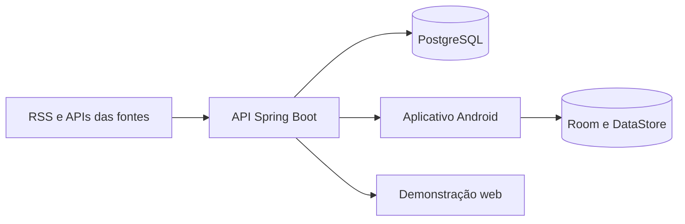

# TechFeed BR

Aplicativo Android de notícias de tecnologia e API de agregação desenvolvidos para o TCC. O feed reúne publicações de diferentes fontes, prioriza conteúdo em português e permite buscar, filtrar, salvar e ler na publicação original.

## Código e documentação

| Componente | Código | Documentação |
| --- | --- | --- |
| Aplicativo Android | [`mobile/`](mobile/) | [Uso, arquitetura e build do aplicativo](docs/APP.md) |
| API e coleta de notícias | [`backend/`](backend/) | [Endpoints, fontes e operação da API](docs/API.md) |

A [especificação do produto](docs/TECHFEED_SPEC.md) registra requisitos, decisões e evidências. A [demonstração web](https://tcc.brenopaiva.dev/) permite testar as jornadas em um navegador; seu código permanece em um repositório Git separado. O [APK de demonstração](https://api.brenopaiva.dev/static/techfeed/TechFeedBR-release.apk) é a versão Android 0.4.0 publicada para o TCC.

## Como funciona



As fontes ativas são Agência Brasil/EBC, DEV Community, Tecnoblog, Olhar Digital, TudoCelular, Hardware.com.br, Mundo Conectado, MacMagazine e Adrenaline. GNews e TabNews estão desabilitados. A API normaliza, deduplica e pagina notícias; os clientes exibem conteúdo real recebido ou salvo antes de recorrer a exemplos identificados. Os exemplos não entram no banco nem nos dados de avaliação.

## Início rápido

Requisitos: Docker com Compose para a API; JDK 17 e Android Studio/SDK Android 37 para o aplicativo.

```sh
docker compose up --build
```

Verifique `http://localhost:8080/actuator/health` e `http://localhost:8080/api/v1/feed`. Depois abra `mobile/` no Android Studio e execute `app` em um emulador Android 8.0 ou superior. O debug usa `http://10.0.2.2:8080/` por padrão.

```sh
cd backend && ./mvnw verify
cd ../mobile && ./gradlew testDebugUnitTest assembleDebug
```

No Windows, use `mvnw.cmd` e `gradlew.bat`. Há testes instrumentados em `mobile/app/src/androidTest/`.

## Configuração e publicação

`.env.example` contém valores apenas para desenvolvimento. Credenciais reais, `.env`, keystore e `mobile/signing.local.properties` não são versionados. A [documentação da API](docs/API.md) explica as variáveis e a implantação; a [documentação do app](docs/APP.md) descreve os builds debug e release. Arquivos operacionais sem segredos ficam em [`deploy/`](deploy/README.md).

Este repositório contém o aplicativo e a API. A parte teórica do TCC e os artefatos gerados não fazem parte do código-fonte publicado.
